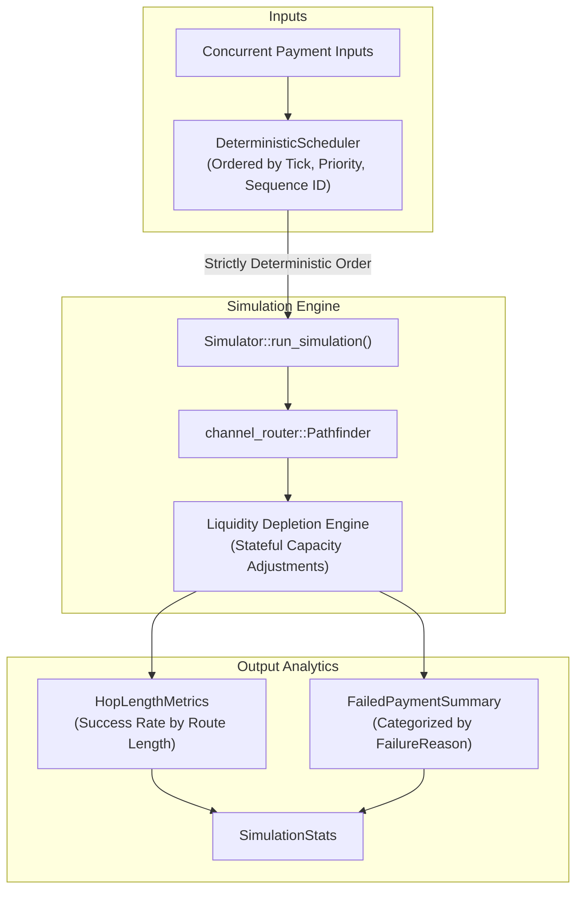

# Payment Channel Network Simulation & Routing Metrics

> **Component:** `crates/channel-simulator`  
> **Related Issues:** #383, #384, #385, #386, #387  
> **Scope:** Baseline network regression fixtures, deterministic event scheduling, channel liquidity depletion, comprehensive failure summaries, and hop-length success metrics.

---

## 1. Executive Summary

This update strengthens the Stellar Payment Channel Network Simulator with deterministic regression capabilities, stateful channel liquidity updates, robust diagnostic summaries, and granular routing performance analytics.

---

## 2. Feature Specifications & Invariants

### 2.1 Baseline Network Fixtures (#387)
- **`NetworkFixture::linear(hops, capacity)`**: Constructs an unbranched chain of `N + 1` nodes joined in sequence with symmetric initial balances.
- **`NetworkFixture::diamond(capacity, fee_rate_upper, fee_rate_lower)`**: Constructs a 4-node diamond network with distinct fee regimes across parallel branches to verify Dijkstra cost minimization.
- **`NetworkFixture::baseline_routing_regression_fixture()`**: Canonical 6-node fixture (`src`, `relay_a`, `relay_b`, `hub_c`, `gw_d`, `dst`) providing two primary multi-hop paths and a bottleneck channel. Eliminates random graph non-determinism in routing algorithm regression suites.

### 2.2 Deterministic Event Ordering (#385)
- Concurrent simulation inputs are scheduled via `SimulationEvent` tuples containing `(tick, priority, sequence_id, source, destination, amount)`.
- Implements `Ord` and `PartialOrd` to enforce total ordering:
  $$\text{event}_1 < \text{event}_2 \iff (\text{tick}_1 < \text{tick}_2) \lor (\text{tick}_1 = \text{tick}_2 \land \text{priority}_1 > \text{priority}_2) \lor \dots$$
- Guarantees identical simulation trajectories across repeated executions and independent test threads.

### 2.3 Channel Liquidity Depletion Modeling (#384)
- When `config.model_liquidity_depletion` is enabled, successful payments shift balances statefully across all hops:
  $$\text{capacity}_{u \to v}' = \text{capacity}_{u \to v} - \text{amount}$$
  $$\text{capacity}_{v \to u}' = \text{capacity}_{v \to u} + \text{amount}$$
- Channels with insufficient balance in the forward direction trigger `FailureReason::ChannelDepleted` and abort without partial state mutations.
- The simulator tracks `channels_depleted_count` to measure network congestion.

### 2.4 Categorized Failure Diagnostics (#386)
- Payments that fail during simulation are recorded with actionable root causes:
  - `NoRouteFound`: Graph disconnect or missing path.
  - `InsufficientLiquidity`: Initial path capacity below payment requirements.
  - `FeeExceededBudget`: Forwarding fees exceed sender's budget.
  - `MaxHopsExceeded`: Path exceeds maximum allowed hops.
  - `ChannelDepleted`: Forward liquidity exhausted by prior transactions.
  - `SourceEqualsDestination`: Invalid loopback payment.
- `FailedPaymentSummary::format_report()` provides machine-readable and tabular diagnostic breakdowns.

### 2.5 Route Length Success Metrics (#383)
- Performance is tracked per hop distance ($H = 1, 2, 3, \dots$):
  $$\text{success\_rate}(H) = \frac{\text{successes}(H)}{\text{attempts}(H)} \times 100\%$$
- Records `total_fees` and calculates average fee per hop distance.
- Accessible directly via `stats.success_rate_for_hops(hops)`.

---

## 3. Verification & Test Coverage

The implementation includes comprehensive unit tests verifying:
1. `test_baseline_network_fixture_routing_regression`: Deterministic 2-hop routing over the 6-node regression fixture.
2. `test_deterministic_event_ordering`: Multi-threaded event scheduling stability and priority tie-breaking.
3. `test_channel_liquidity_depletion_modeling`: Stateful channel depletion under continuous volume.
4. `test_payment_success_rate_by_route_length_and_failed_summaries`: Hop metric collation and failure diagnostic formatting.
